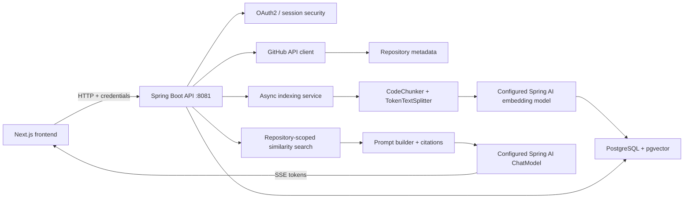

# huGit

huGit is a work-in-progress code-repository chat application. The implemented backend can synchronize a user's GitHub repositories, index eligible source files into PostgreSQL/pgvector, retrieve similar code chunks, and stream chat responses with file metadata attached as citations. A Next.js frontend provides authentication, repository management, indexing status, and chat views.

The repository also contains initial Hugging Face domain models and adapters, but that path is not complete. The Compose file provisions PostgreSQL and Ollama and includes a one-shot model-pull job; however, the backend and frontend service definitions remain commented out, and the backend's Spring AI dependencies and configuration are not wired to Ollama. The `Model/ModelFile` is a separate, unused Ollama model definition.

## Features

- GitHub OAuth login and authenticated repository synchronization.
- Code-file filtering, language detection, size limits, token-based chunking, and asynchronous indexing.
- PostgreSQL persistence with the `vector`, `hstore`, and `uuid-ossp` extensions.
- pgvector similarity search restricted to the selected repository.
- Chat sessions and persisted user/assistant messages.
- Server-Sent Events (SSE) for user-message, token, assistant-message, and completion events.
- Citation objects containing file path, language, and optional line range.
- Next.js dashboard for repositories, indexing progress, sessions, and streamed chat.
- CORS and HTTP-only session-cookie configuration for a separately hosted frontend.

## Technology stack

| Technology | Responsibility |
|---|---|
| Java 21 | Backend runtime |
| Spring Boot 4.1.1 | Web, security, configuration, and application framework |
| Spring AI 2.0.0 | Chat model and vector-store abstractions |
| Spring Data JPA / Hibernate | Relational persistence |
| PostgreSQL 16 + pgvector | Application data and vector similarity search |
| Next.js 16 / React 19 / TypeScript | Frontend |
| Maven | Backend build |
| npm | Frontend build |
| Docker | Backend and frontend images; PostgreSQL image |
| Ollama | Containerized local model runtime provisioned by Compose |
| Docker Compose | PostgreSQL and Ollama infrastructure orchestration |

## Architecture

The implemented GitHub flow is:

1. The browser authenticates through the backend's OAuth2 endpoints.
2. The backend stores the provider connection and synchronizes repository metadata.
3. Indexing runs asynchronously. The GitHub adapter lists the repository tree, filters eligible files, fetches file contents, and creates `TokenTextSplitter` chunks.
4. Spring AI adds chunks to pgvector with repository, path, language, chunk index, and source-type metadata.
5. A chat request retrieves the top eight similar chunks for the selected repository.
6. The prompt builder combines retrieved text with the question.
7. The configured Spring AI `ChatModel` streams tokens through an SSE emitter; the completed answer and citation JSON are persisted.



The Compose layer includes an Ollama runtime and pulls `gemma3:4b` plus `qwen3-embedding:0.6b` into a persistent volume. The application layer does not yet consume that runtime because the backend service is commented out and no Ollama Spring AI integration is present in the backend dependencies or properties.

## RAG pipeline

### Implemented GitHub path

1. **Discovery:** `GitHubRepositoryService` calls the GitHub API and stores repository metadata.
2. **Ingestion:** `GitHubIndexingAdapter` obtains the repository tree and filters blobs using the GitHub code-file filter and `app.indexing.max-file-bytes`.
3. **Chunking:** `CodeChunker` prepends the file path and splits content with Spring AI's token splitter. Defaults are derived from `app.indexing.chunk-size`.
4. **Embedding and storage:** `VectorStore.add` writes documents to the pgvector-backed store in batches of 32.
5. **Retrieval:** `CodeContextRetriever` performs cosine-distance similarity search, limited to eight chunks and filtered by repository ID.
6. **Context construction:** retrieved document text is joined with separators; citation metadata is mapped from each document.
7. **Generation:** `ChatStreamHandler` sends the prompts to the configured Spring AI `ChatModel`.
8. **Streaming and persistence:** SSE token events are emitted, then the complete assistant message and citation list are saved.

The repository contains a `HuggingFaceIndexingAdapter`, but fetching content, chunking, progress updates, and ready/failed state updates are empty. Hugging Face ingestion is therefore not an implemented end-to-end pipeline.

## Project structure

```text
.
├── Backend/
│   ├── pom.xml
│   ├── Dockerfile
│   └── src/
│       ├── main/java/backend/hugitbackend/
│       │   ├── config/              # Spring, CORS, crypto, and security configuration
│       │   ├── controller/          # Auth, chat, user, GitHub, and HF HTTP controllers
│       │   ├── dto/                 # API request/response types
│       │   ├── entity/              # JPA entities and enums
│       │   ├── repository/          # JPA repositories
│       │   ├── security/             # Current-user and OAuth provider services
│       │   └── service/
│       │       ├── ai/               # Retrieval, prompts, streaming, and citations
│       │       ├── github/            # GitHub API and repository services
│       │       ├── huggingface/       # HF services (partially implemented)
│       │       └── indexing/          # Adapters, filtering, chunking, and indexing
│       ├── main/resources/application.properties
│       └── test/
├── frontend/
│   ├── app/                          # Login, callback, dashboard, and chat routes
│   ├── components/                   # Chat, dashboard, layout, and UI components
│   ├── hooks/                        # Auth, repository, chat, and responsive hooks
│   ├── lib/api.ts                    # Typed REST client
│   ├── lib/stream-chat.ts            # SSE parser
│   ├── Dockerfile
│   └── package.json
├── docker/postgres/init-extensions.sql
├── Model/ModelFile                    # Standalone Ollama model definition, not wired to the backend
├── RAG/Archi1.jpg
├── RAG/Archi2.jpg
└── docker-compose.yaml                # PostgreSQL, Ollama, and model-pull services
```

## Prerequisites

For the currently implemented path:

- Java 21 and Maven 3.9+ for local backend development, or Docker.
- Node.js 20+ and npm for local frontend development, or Docker.
- Docker Desktop with Compose.
- PostgreSQL 16 with pgvector if running the database outside Compose.
- OAuth application credentials for the configured GitHub login flow.
- Sufficient PostgreSQL disk space for indexed documents and vectors.
- Additional disk space for the Ollama volume, which stores the pulled Gemma and Qwen embedding models.

## Local development setup

### 1. Clone the repository

```bash
git clone <repository-url>
cd GithubRAG
```

### 2. Start PostgreSQL and Ollama

```bash
docker compose up -d postgres ollama
docker compose ps
```

The database is exposed at `localhost:5433`, uses database `huGit`, user `postgres`, and the default Compose password `postgres`. The initialization script enables the required PostgreSQL extensions. Ollama is exposed at `localhost:11434`. The named volumes `huGit_pg_data` and `huGit_ollama_data` persist database data and downloaded models.

To pull the configured models after Ollama becomes healthy:

```bash
docker compose run --rm ollama-pull
```

The pull job downloads `gemma3:4b` and `qwen3-embedding:0.6b`. This prepares the Ollama volume, but does not connect those models to the backend.

### 3. Configure the backend

Set the variables described below in the backend process environment. Do not commit credentials. `Backend/scratch_example.env` is only a partial example and is not automatically loaded by Spring Boot.

Run the backend:

```bash
cd Backend
./mvnw spring-boot:run
```

On Windows:

```powershell
cd Backend
.\mvnw.cmd spring-boot:run
```

The API listens on `http://localhost:8081`.

### 4. Run the frontend

In another terminal:

```bash
cd frontend
npm ci
$env:NEXT_PUBLIC_API_BASE_URL="http://localhost:8081"  # PowerShell
npm run dev
```

For POSIX shells, use `NEXT_PUBLIC_API_BASE_URL=http://localhost:8081 npm run dev`. Open `http://localhost:3000`.

### 5. Authenticate and index

Use the GitHub login flow, allow the requested scopes, refresh the repository list, and start indexing a repository. A chat session can be created only after its repository reports `READY`.

## Environment variables

These are the application variables referenced by `application.properties` or the frontend client. Values below are examples only.

| Variable | Purpose | Example | Required |
|---|---|---|---|
| `DB_URL` | JDBC database URL | `jdbc:postgresql://localhost:5433/huGit` | No; default exists |
| `DB_USERNAME` | Database user | `postgres` | No; default exists |
| `DB_PASSWORD` | Database password | `<database-password>` | Yes for a non-default deployment |
| `JWT_SECRET` | JWT signing secret | `<long-random-secret>` | Yes |
| `FRONTEND_URL` | OAuth failure redirect and frontend URL | `http://localhost:3000` | No; default exists |
| `CORS_ALLOWED_ORIGINS` | Comma-separated allowed browser origins | `http://localhost:3000` | No; default exists |
| `TOKEN_ENCRYPTOR_SALT` | Salt used for stored provider-token encryption | `<hex-salt>` | No; source default exists; replace for real deployments |
| `GITHUB_CLIENT_ID` | GitHub OAuth client ID | `<client-id>` | Yes for GitHub login |
| `GITHUB_CLIENT_SECRET` | GitHub OAuth client secret | `<client-secret>` | Yes for GitHub login |
| `NEXT_PUBLIC_API_BASE_URL` | Frontend base URL for backend requests | `http://localhost:8081` | No; frontend default exists |

The backend also declares provider-specific chat and embedding settings in `application.properties`. Those settings currently refer to a non-local inference configuration, so they are not documented as an offline/Ollama setup. No secrets or real credentials belong in this repository.

## Docker Compose deployment

The checked-in `docker-compose.yaml` defines these active services:

| Service | Image | Host port | Persistence |
|---|---|---:|---|
| `postgres` | `pgvector/pgvector:pg16` | `5433` | `huGit_pg_data` |
| `ollama` | `ollama/ollama:latest` | `11434` | `huGit_ollama_data` |
| `ollama-pull` | `ollama/ollama:latest` | None | Uses the Ollama volume through the `ollama` service |

`postgres` and `ollama` have health checks. `ollama-pull` waits for the Ollama health check, downloads the two configured model artifacts, and exits successfully. Backend and frontend service definitions are present but commented out, so the complete application is not started by Compose.

```bash
docker compose up -d postgres ollama
docker compose run --rm ollama-pull
docker compose ps
docker compose logs -f ollama
docker compose stop
docker compose down
docker compose down -v       # Deletes the database volume; destructive
```

The Compose file includes commented backend and frontend definitions with intended internal URLs (`postgres:5432` and `http://ollama:11434`), but they are not active. `Backend/Dockerfile` and `frontend/Dockerfile` can build standalone images; enabling those services requires completing the backend's Ollama integration and supplying its environment. The current file is therefore infrastructure for PostgreSQL and Ollama, not a complete self-hosted application deployment.

## API reference

All `/api/**` endpoints require an authenticated session unless noted otherwise. Requests from the frontend include credentials, and errors are handled by the global exception handler.

### Authentication

| Method | Endpoint | Purpose | Response |
|---|---|---|---|
| `GET` | `/api/auth/github/login-url` | Returns the GitHub OAuth authorization path | `{"url":"/oauth2/authorization/github"}` |
| `GET` | `/api/auth/huggingface/login-url` | Returns the Hugging Face OAuth authorization path | Same shape; the downstream HF flow is incomplete |
| `GET` | `/api/auth/me` | Returns the current authenticated user | `UserResponse` |
| `POST` | `/api/auth/logout` | Invalidates the session and cookie | `204 No Content` |

OAuth callback routes are handled by Spring Security at `/oauth2/**` and `/login/oauth2/**`.

### GitHub repositories

| Method | Endpoint | Parameters/body | Purpose |
|---|---|---|---|
| `GET` | `/api/repos?refresh=true` | Optional `refresh` boolean, default `true` | Synchronizes and lists the authenticated user's repositories |
| `GET` | `/api/repos?refresh=false` | Optional `refresh=false` | Lists stored repositories without synchronization |
| `GET` | `/api/repos/{repoId}` | Path UUID | Returns an owned repository |
| `GET` | `/api/repos/{repoId}/status` | Path UUID | Returns indexing status and counts |
| `POST` | `/api/repos/{repoId}/index` | Path UUID, no body | Starts asynchronous indexing; returns `202 Accepted` and repository data |

### Chat

| Method | Endpoint | Body/query | Response |
|---|---|---|---|
| `POST` | `/api/chat/sessions` | `{"repositoryId":"<uuid>","title":"optional title"}` | `ChatSessionResponse` |
| `GET` | `/api/chat/sessions?repositoryId=<uuid>` | Repository UUID query parameter | Array of sessions |
| `GET` | `/api/chat/sessions/{id}` | Session UUID | Array of messages |
| `POST` | `/api/chat/sessions/{id}/messages` | `{"content":"question"}` | `text/event-stream` |

The message stream emits:

```text
event: user_message
data: <ChatMessageResponse JSON>

event: token
data: "<token JSON string>"

event: assistant_message
data: <ChatMessageResponse JSON>

event: done
data: [DONE]
```

`POST /api/user/{id}` exists in the controller, but its service dependency is not initialized in the current class and it should not be treated as a supported endpoint.

### Hugging Face

The repository contains model, DTO, OAuth, API-client, and indexing classes, but no working repository-controller operations are exposed. The Hugging Face indexing adapter has empty core methods. There is no documented working Hugging Face ingestion API.

## Current limitations

- **Backend Ollama integration is not implemented.** Compose provisions Ollama and pulls `gemma3:4b` plus `qwen3-embedding:0.6b`, but the backend does not configure an Ollama client or use those models. `Model/ModelFile` is not consumed by the backend.
- **The current AI configuration is not self-contained.** Chat and embeddings require the provider configuration declared in `application.properties`; this conflicts with the intended fully offline architecture.
- **Compose application services are incomplete.** Backend and frontend services are commented out, so Compose currently launches infrastructure only.
- **Hugging Face ingestion is incomplete.** The adapter's content fetch, chunking, progress, and terminal-state methods are empty, and repository service/controller operations are stubs.
- **Citation line ranges are not currently generated.** The mapper can read `startLine` and `endLine`, but `CodeChunker` does not set them.
- **GitHub indexing has implementation defects requiring review.** For example, the GitHub adapter's file-content call passes the repository owner where the repository name is expected.
- **Test coverage is minimal.** The repository contains a Spring application-context test but no comprehensive indexing, retrieval, SSE, API, or frontend test suite.
- **Database schema management uses `spring.jpa.hibernate.ddl-auto=update`;** production migrations are not provided.

## Troubleshooting

### PostgreSQL will not start

```bash
docker compose ps
docker compose logs postgres
```

Confirm that port `5433` is free. If an old data volume is incompatible, back it up before using `docker compose down -v`; that command deletes persisted database data.

### Backend cannot connect to PostgreSQL

Confirm the database is healthy and that `DB_URL` uses host port `5433` when the backend runs on the host. A backend container must use the Compose service name and container port (`postgres:5432`) instead.

### OAuth login fails

Check the OAuth client credentials, callback registration, `FRONTEND_URL`, and `CORS_ALLOWED_ORIGINS`. The browser must be able to reach both `localhost:3000` and `localhost:8081`, and cookies must be sent with credentials.

### Indexing remains failed

Inspect backend logs and `/api/repos/{repoId}/status`. Verify the OAuth token has repository read access, the repository branch exists, the GitHub API is reachable, and files are below `app.indexing.max-file-bytes`.

### Chat or embedding calls fail

Confirm that `ollama` is healthy and that `ollama-pull` completed successfully:

```bash
docker compose ps
docker compose run --rm ollama-pull
```

The backend still requires a completed Ollama integration; pulling models alone will not make the current backend use them.

### Frontend cannot reach the API

Set `NEXT_PUBLIC_API_BASE_URL` before starting Next.js, verify the backend is listening on port `8081`, and ensure the backend CORS origin exactly matches the frontend origin.

## Future improvements

These are intentionally not presented as current features:

- Replace the current Spring AI model configuration with a verified local Ollama chat and embedding integration.
- Enable backend and frontend services in Compose and wire service-name URLs correctly.
- Complete Hugging Face repository discovery, content retrieval, indexing, and status persistence.
- Add reliable line-offset metadata for citations.
- Fix and test GitHub content retrieval, then add integration tests for indexing, retrieval, SSE, and OAuth.
- Introduce versioned database migrations and production-safe secret management.

## Contributing

No contribution guide, issue template, or project license is present in the repository. Until those files are added, contributors should keep changes scoped, avoid committing credentials, run the relevant backend or frontend checks, and describe configuration changes in the pull request.
